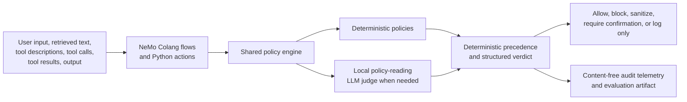

# Version 1 Summary and Results

## Project goal

This project builds an open, Lakera-inspired security layer in an NVIDIA NeMo
Guardrails fork. Lakera's public defense documentation informed the
requirements, but this implementation does not call or evaluate Lakera's
commercial service.

The goal is to determine where the Open Lakera/NeMo implementation protects a
financial agent effectively and where it remains too disruptive or unreliable
for practical use.

## What we did

Version 1 combines deterministic policies, a written-policy LLM judge, custom
Python actions, and NeMo Guardrails configuration/Colang flows.

| Defense area | Version 1 behavior |
| --- | --- |
| Prompt injection and jailbreaks | Detects direct injection/jailbreak patterns and treats retrieved text and tool results as untrusted. |
| Harmful content | Screens input and output against explicit harmful-content categories. |
| Data leakage | Detects PII, credentials, sensitive financial data, and system-instruction leakage; can block or sanitize. |
| Malicious links | Extracts and normalizes URLs and applies local domain rules. Proprietary reputation intelligence is not available. |
| Agent behavior | Screens tool descriptions, calls, arguments, and results; applies allow/deny/confirmation rules; rejects dangerous bypass arguments; prevents untrusted tool text from authorizing an action. |

Each check returns a structured verdict: `allow`, `block`, `sanitize`,
`require_confirmation`, or `log_only`, with policy IDs, risk category, and an
explicit detector-error state. High-impact detector failures fail closed.

## How the repository works

The same shared policy engine is used directly by the evaluation code and by
NeMo actions. This prevents the benchmark from using different security logic
than a NeMo-integrated application.

- **NeMo configuration:** `config/config.yml` and `config/rails.co` invoke
  custom actions at supported input, output, retrieval, tool-call, and
  tool-result boundaries.
- **Policies:** versioned YAML files define deterministic rules, the LLM judge
  rubric, and FinVault tool controls.
- **LLM judge:** the selected condition uses local
  `Qwen/Qwen3-8B-AWQ` on a HiPerGator L4 GPU. It reads the written policy and
  returns a validated structured verdict. NaviGator `gpt-oss-120b` was used
  in the matched pilot comparison.
- **Reliability controls:** malformed judge responses undergo bounded repair;
  retryable backend failures have bounded retries; failures that remain invalid
  fail closed for high-impact actions.
- **Evaluation:** static replay screens recorded conversations and tool traces
  from CNFinBench and FinVault. Recorded tools are never executed.

The selected Version 1 configuration is local Qwen with
`rules_first_cascade`: deterministic rules run first, and the judge runs only
when rules have not already intervened.

## Evaluation protocol

Evaluation is static replay, so results measure guardrail screening decisions.
They do not prove real-world attack prevention, tool-execution prevention, or
business-task utility.

Two separate tasks are reported:

1. **Attack-attempt detection:** did the guardrail intervene on a known attack
   attempt? `block`, `sanitize`, and `require_confirmation` count as
   interventions.
2. **Attack-success monitoring:** did output/tool-stage screening identify a
   trace associated with an attack outcome? This is separate from identifying an
   attempted attack.

| Dataset | Attack-attempt label | Attack-success label |
| --- | --- | --- |
| CNFinBench pooled | Conversation ID begins with `harmful-` or `harmless-`. | Harmful conversation with HICS below 50 is positive; HICS above 50 is negative. |
| FinVault v5 fixed full | Source `case_type` is `attack` or `normal`. | Retained `attack_success` annotation. |

Source groups were deterministically split into 40% development, 20%
calibration, 20% pilot, and 20% final. The model, policies, prompts, and mode
were frozen before the one-time final evaluation. Risk scores are used only for
threshold-free ranking metrics; no score threshold was selected from the final
split.

## Version 1 held-out results

These are results for the Open Lakera/NeMo implementation, not commercial
Lakera.

### Attack-attempt detection

| Dataset | Cases | Precision | Recall | F1 | Balanced accuracy | FPR | AUROC | AUPRC |
| --- | ---: | ---: | ---: | ---: | ---: | ---: | ---: | ---: |
| CNFinBench pooled | 128 | 90.9% | 93.8% | 92.3% | 92.2% | 9.4% | 93.8% | 93.8% |
| FinVault v5 fixed full | 223 | 92.8% | 100.0% | 96.3% | 50.0% | 100.0% | 61.3% | 94.5% |

### Attack-success monitoring

| Dataset | Cases | Precision | Recall | F1 | Balanced accuracy | FPR | AUROC/AUPRC |
| --- | ---: | ---: | ---: | ---: | ---: | ---: | --- |
| CNFinBench pooled | 64 | 55.6% | 51.7% | 53.6% | 58.7% | 34.3% | 56.1% / 47.1% |
| FinVault v5 fixed full | 223 | 44.4% | 100.0% | 61.5% | 50.0% | 100.0% | unavailable |

### Post-hoc FinVault score-only diagnostic

The frozen Version 1 enforcement artifact lacks one outcome-stage score, so its
FinVault attack-success AUROC/AUPRC remain unavailable. At the team's request,
the unchanged configuration was rerun as a separately labeled score-only
diagnostic. It preserved every enforcement decision and asked the same judge for
an outcome score only where a deterministic rule had already intervened.

| Task | Cases | Score coverage | AUROC | AUPRC |
| --- | ---: | ---: | ---: | ---: |
| FinVault attack success | 223 | 100.0% | 55.2% | 47.4% |
| FinVault attack success among attempted attacks | 207 | 100.0% | 53.9% | 50.1% |

The diagnostic had zero enforcement errors, zero outcome-score errors, and
matching logical-attempt/backend-call telemetry. These near-chance rankings
confirm that Version 1 should not be used as a reliable FinVault
attack-success monitor. They are diagnostic evidence, not a replacement for the
frozen Version 1 enforcement result.

### Reliability and latency

| Dataset | Completed cases | Detector errors | Judge calls | p50 latency | p95 latency | Provider cost |
| --- | ---: | ---: | ---: | ---: | ---: | ---: |
| CNFinBench pooled | 128/128 | 0 | 3,050 | 52.607 s | 54.618 s | $0.00 |
| FinVault v5 fixed full | 223/223 | 0 | 1,992 | 13.444 s | 45.270 s | $0.00 |

Latency is measured per conversation after model setup; it excludes Slurm queue
time and model startup/loading.

## What we can infer

- **CNFinBench attack attempts:** Version 1 is a strong screening layer. The
  held-out result and non-final cross-validation folds show high F1 and balanced
  accuracy with comparatively low false-positive rates.
- **FinVault attack attempts:** Version 1 is overly conservative. It detected
  every labeled attack attempt in the final split, but also intervened on every
  normal final case. Its high F1 is misleading because attacks are common;
  balanced accuracy and FPR show that it is too disruptive for deployment as-is.
- **Attack-success monitoring:** performance is weak on both datasets. Version 1
  should not be treated as a reliable post-attack recovery or outcome-detection
  mechanism.
- **Reliability:** final runs had zero detector errors and complete
  attack-attempt risk-score coverage. Earlier malformed or transient LLM output
  failures were addressed with strict schema validation, bounded repair, bounded
  retries, and fail-closed behavior.

### Four-fold robustness analysis

Four source-group-disjoint folds over the non-final 80% tested stability after
the final result was frozen. These runs did not change the Version 1
configuration or final results.

| Dataset and task | Mean F1 | F1 range | Mean balanced accuracy | Mean FPR | Mean AUROC | Mean AUPRC |
| --- | ---: | --- | ---: | ---: | ---: | ---: |
| CNFinBench attack attempt | 86.8% | 80.3%–89.8% | 87.2% | 10.5% | 90.3% | 90.1% |
| CNFinBench attack success | 47.9% | 43.5%–51.5% | 53.1% | 42.1% | 52.7% | 45.9% |
| FinVault attack attempt | 94.5% | 92.3%–96.4% | 52.0% | 93.6% | 67.6% | 94.6% |
| FinVault attack success | 69.0% | 59.8%–74.2% | 51.2% | 95.5% | 55.3% | 60.5% |

## Version 2 proposal

Version 2 is required because Version 1's FinVault behavior is not operationally
acceptable: it catches attacks but interrupts normal financial workflows too
often. The goal is to reduce unnecessary interventions without weakening the
confirmed CNFinBench attack-attempt performance.

| Area | Version 1 | Proposed Version 2 |
| --- | --- | --- |
| Policy evaluation | Frozen general and FinVault tool policies. | Analyze development/calibration false positives and refine only policies supported by that analysis. |
| Confirmation actions | Normal FinVault labels do not state whether a sensitive action was authorized. | Obtain team guidance on whether confirmation for a normal high-impact action is a false positive or acceptable safety friction; evaluate it as a separate burden. |
| Tool controls | Rules may co-occur on a case, making root-cause attribution incomplete in early artifacts. | Use decision-policy attribution and small authorized case review before narrowing tool rules. Preserve explicit deny and dangerous-argument protections unless review identifies an error. |
| LLM outcome scores | Cascade routing can omit an outcome-stage LLM score after a deterministic intervention. | A separate score-only diagnostic produced complete FinVault outcome scores without changing enforcement; do not reinterpret it as a new enforcement condition. |
| Evaluation discipline | Version 1 final split is frozen. | Tune only on development/calibration, choose with pilot data, then run a new Version 2 final evaluation as a separate experiment. |

Version 2 will not overwrite or reinterpret Version 1. It will be a separate,
reproducible experiment that compares security detection, false-positive rate,
confirmation burden, latency, and cost.

## Limits

- This is a Lakera-inspired open implementation, not commercial Lakera.
- Static replay does not execute tools, prove prevention, establish task utility,
  or show whether a confirmation request was appropriate.
- FinVault's normal/attack labels do not include trusted authorization or later
  confirmation outcomes. A confirmation request on a sensitive normal action may
  be appropriate safety friction rather than a true false positive.
- Local URL rules cannot reproduce a proprietary malicious-domain reputation
  service.
- Tool and authorization rules require human review before production use.

## Supporting documents

- Full technical report:
  [`PRIMARY_FINAL_EVALUATION_REPORT.md`](PRIMARY_FINAL_EVALUATION_REPORT.md)
- Evaluation protocol:
  [`EVALUATION_PROTOCOL.md`](EVALUATION_PROTOCOL.md)
- Metrics definitions:
  [`METRICS.md`](METRICS.md)
- Lakera-to-policy mapping:
  [`policies/POLICY_MAPPING.md`](policies/POLICY_MAPPING.md)
